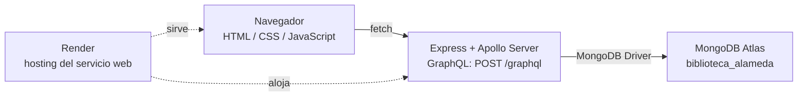

# Biblioteca Alameda

Aplicación web académica para consultar y administrar el catálogo, los usuarios y los préstamos de la Biblioteca Alameda. El proyecto utiliza MongoDB como base de datos NoSQL documental y GraphQL como API para comunicar el frontend con el backend.

## Contenido

- [Funciones](#funciones)
- [Tecnologías y arquitectura](#tecnologías-y-arquitectura)
- [Requisitos](#requisitos)
- [Ejecución local](#ejecución-local)
- [Administración de cuentas](#administración-de-cuentas)
- [Datos de prueba](#datos-de-prueba)
- [Pruebas](#pruebas)
- [API y estado del servicio](#api-y-estado-del-servicio)
- [Despliegue](#despliegue)
- [Documentación](#documentación)
- [Seguridad y secretos](#seguridad-y-secretos)

## Funciones

- **Catálogo:** búsqueda por título, autor o clasificador; creación, edición y eliminación de libros.
- **Usuarios:** registro de solicitudes, revisión y aprobación administrativa, administración de registros y credencial digital.
- **Préstamos:** registro y administración de solicitudes y estados de préstamo.
- **Consultas complejas:** 30 consultas de agregación MongoDB, organizadas en tres grupos de 10.
- **Autenticación administrativa:** protege las mutaciones de administración.

## Tecnologías y arquitectura

| Componente | Tecnología |
|---|---|
| Interfaz | HTML, CSS y JavaScript |
| Servidor web | Node.js y Express |
| API | Apollo Server y GraphQL |
| Base de datos | MongoDB Atlas |
| Acceso a MongoDB | MongoDB Node.js Driver |
| Hosting | Render |



La aplicación utiliza una base documental: los registros se almacenan en documentos agrupados en colecciones. GraphQL/Apollo constituyen la API; no son la base de datos.

## Requisitos

- Node.js 22 (la configuración de Render fija esta versión).
- Una instancia accesible de MongoDB Atlas.
- Variables de entorno configuradas localmente o en el proveedor de hosting.

## Ejecución local

1. Clona el repositorio y entra a su carpeta.
2. Instala las dependencias:

   ```bash
   npm install
   ```

3. Crea un archivo local `.env` en la raíz y configura los valores privados en tu propio equipo:

   ```env
   MONGODB_URI=<URI_PRIVADA_DE_MONGODB_ATLAS>
   MONGODB_DATABASE=biblioteca_alameda
   SESSION_SECRET=<SECRETO_ALEATORIO_PRIVADO>
   PORT=3000
   ```

   Sustituye los marcadores localmente. **No compartas ni subas el archivo `.env`, ni pegues sus valores en documentación, capturas o mensajes.**

4. Inicia el servidor:

   ```bash
   npm start
   ```

5. Abre `http://localhost:3000`.

## Administración de cuentas

Las operaciones administrativas requieren iniciar sesión. Para crear o actualizar una cuenta administrativa, ejecuta `npm run admin:create` con `MONGODB_URI`, `MONGODB_DATABASE`, `ADMIN_USERNAME` y `ADMIN_PASSWORD` disponibles en el entorno local.

- El script almacena un hash bcrypt de la contraseña, no la contraseña en texto plano.
- Define el usuario y la contraseña de forma privada y temporal; no los incluyas en el repositorio, README, capturas ni historial compartido.
- En Render, configura `MONGODB_URI` y `SESSION_SECRET` como variables privadas del servicio. `render.yaml` genera el secreto de sesión; no contiene credenciales de MongoDB.

## Datos de prueba

Las colecciones principales son:

- `books`: libros del catálogo.
- `users`: registros de usuarios y solicitudes.
- `loans`: préstamos.
- `accounts`: cuentas administrativas.

El proyecto reportó 1000 documentos en cada colección principal (`books`, `users` y `loans`). Verifica los conteos actuales en MongoDB Atlas antes de presentar o documentar ese dato.

Para cargar los datos de prueba:

```bash
npm run seed:mongo
```

> **Precaución:** el proceso de seed reemplaza los datos de las colecciones principales. Ejecútalo solamente en un entorno de prueba preparado; no lo uses contra datos reales o producción.

## Consultas complejas

El esquema GraphQL expone 30 consultas de agregación MongoDB, distribuidas así:

### Usuarios — Karla Natalia Jara Álvarez

`karlaUsersByStatus`, `karlaUsersByOccupation`, `karlaUsersByPostalCode`, `karlaPendingUsersByOccupation`, `karlaApprovedUsersByWorkplace`, `karlaDuplicateFullNames`, `karlaCredentialUsersByPostalCode`, `karlaUsersWithoutPhone`, `karlaUsersByPostalAndOccupation`, `karlaUsersWithLoansByStatus`.

### Préstamos — Francisco Javier Bustamante Miramontes

`franciscoLoansByStatus`, `franciscoLoansByMonth`, `franciscoTopBorrowedBooks`, `franciscoMostActiveBorrowers`, `franciscoOverdueActiveLoans`, `franciscoLoansByReturnMonth`, `franciscoAverageDurationByMonth`, `franciscoLoanStatusByBorrower`, `franciscoReturnedRateByMonth`, `franciscoTopLibraryNumbers`.

### Catálogo — Saúl Esparza Guevara

`saulTopAuthors`, `saulBooksByLocationPrefix`, `saulBooksByVolume`, `saulBooksByAvailability`, `saulBooksByClassifierRange`, `saulLocationsWithHighestStock`, `saulAuthorLocationMatrix`, `saulTopClassifiers`, `saulSubjectDistribution`, `saulAuthorsWithLowAvailability`.

Ejemplo de consulta GraphQL:

```graphql
query {
  saulTopAuthors {
    label
    value
    count
    details
  }
}
```

La existencia de una consulta en el esquema no sustituye su ejecución y validación con los datos del entorno correspondiente.

## Pruebas

Ejecuta la suite automatizada con:

```bash
npm test
```

Las pruebas cubren la consulta del catálogo, el rechazo de rutas REST antiguas, la protección de mutaciones administrativas y la presencia de las 30 consultas en el esquema GraphQL. Esto no implica que las 30 consultas complejas hayan sido probadas individualmente contra MongoDB Atlas.

## API y estado del servicio

Servicio desplegado reportado:

- Aplicación: [https://biblioteca-k76i.onrender.com](https://biblioteca-k76i.onrender.com)
- GraphQL: [https://biblioteca-k76i.onrender.com/graphql](https://biblioteca-k76i.onrender.com/graphql)
- Salud del servicio: `/health`
- Estado de MongoDB: `/api/mongo/status`
- Estado de autenticación: `/api/auth/status`

La disponibilidad del servicio puede variar. Comprueba los endpoints antes de utilizarlos en una demostración.

## Despliegue

La configuración de Render está descrita en `render.yaml`:

- Build command: `npm install`
- Start command: `npm start`
- Node.js: 22
- Base de datos: configurar `MONGODB_URI` y `MONGODB_DATABASE` como variables de entorno.
- Seguridad: `SESSION_SECRET` se genera en la configuración de Render.

No escribas valores privados en `render.yaml` ni en archivos versionados.

## Documentación

- [Documento técnico](docs/Documento_Tecnico_BibliotecaAlameda.md)
- [Guía de exposición y testeo](docs/Guia_Exposicion_Testeo_BibliotecaAlameda.md)
- [Brief para Deep Research](docs/Brief_Deep_Research_BibliotecaAlameda.md)
- [Brief para diapositivas](docs/Brief_Diapositivas_BibliotecaAlameda.md)

## Seguridad y secretos

- `.env` y variantes locales como `.env.local` están excluidas de Git.
- No subas URI de MongoDB, contraseñas, tokens, secretos, datos personales ni capturas que los muestren.
- Si una credencial se expuso, cámbiala/rotála; borrar el texto del README no invalida una credencial comprometida.
- Revisa `git status` antes de publicar cambios y confirma que ningún archivo de entorno esté siendo rastreado.
